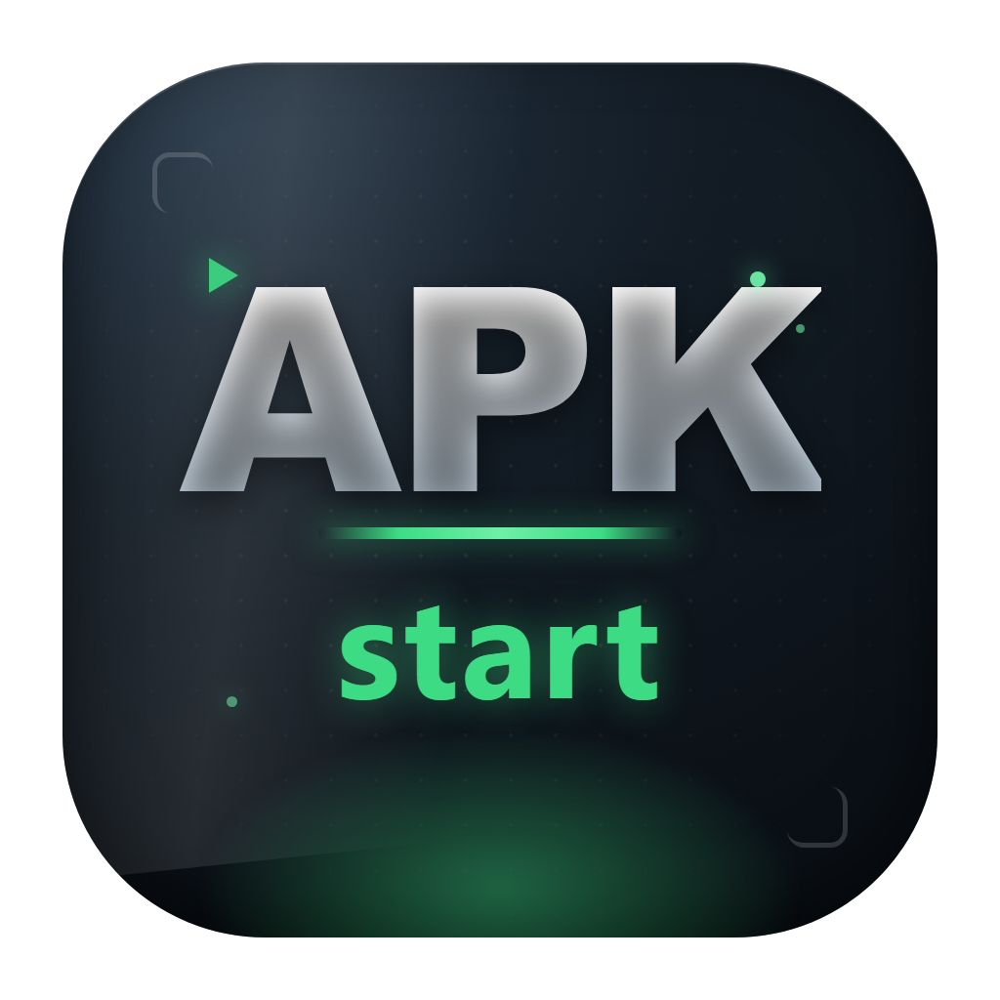
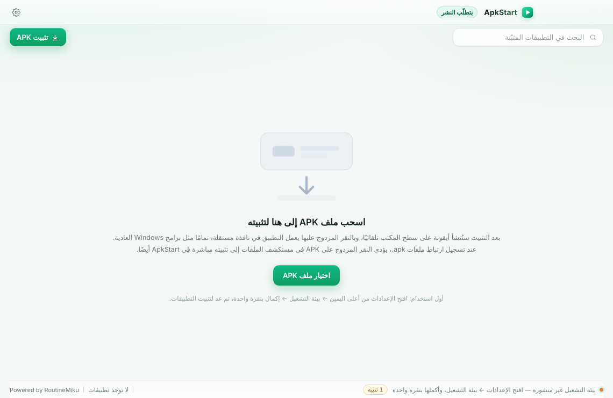

<div dir="rtl">

# ApkStart — النسخة العربية

<p align="center"></p>

**مشغّل تطبيقات Android على Windows: انقر نقرًا مزدوجًا على ملف APK فيُثبَّت، ويعمل كل تطبيق في نافذة مستقلة وبأيقونة على سطح المكتب مثل أي برنامج Windows عادي.**

> الوثيقة الأصلية الكاملة (بالصينية): [README.md](README.md)



## الواجهة بالعربية

الواجهة بالكامل مترجمة إلى العربية وتُعرض **من اليمين إلى اليسار (RTL)**: النافذة الرئيسية، والإعدادات بكل فئاتها، وشاشة البدء، ونافذة التطبيق، وقائمة شريط المهام، والإشعارات، ونوافذ التأكيد، ورسائل الأخطاء والتشخيص.

### طريقة التفعيل

- **تلقائيًا:** إذا كانت لغة Windows عربية، يفتح ApkStart بالعربية مباشرة (الخيار الافتراضي «حسب لغة النظام»).
- **يدويًا:** الإعدادات ← الأساسيات والتثبيت ← **لغة الواجهة · Language · 语言** ← اختر **العربية**.
  تُحدَّث الواجهة فورًا، وبعض نصوص إشعارات النظام تتغيّر عند تشغيل ApkStart في المرة القادمة.

يمكن أيضًا ضبطها من ملف الإعدادات `%APPDATA%\apkstart\settings.json`:

```json
{ "uiLanguage": "ar" }
```

القيم المتاحة: `"auto"` (حسب النظام) · `"ar"` (العربية) · `"zh-CN"` (الصينية المبسّطة).

### لغة نظام Android داخل الجهاز الافتراضي

مع الواجهة العربية يعمل نظام Android داخل الجهاز الافتراضي **بالإنجليزية** افتراضيًا (لغة الصورة الأصلية)، وتُضبط المنطقة الزمنية وفق جهازك.
السبب: في اللغة العربية قد يكتب Android الأرقام بالشكل العربي-الهندي (٠١٢٣)، فيتعذّر على ApkStart قراءة دقة الشاشة والكثافة بشكل صحيح.
يمكنك اختيار العربية لـ Android يدويًا من: الإعدادات ← الأداء والموارد ← **لغة النظام** ← «العربية (تجريبية)». يسري التغيير بعد إعادة تشغيل بيئة التشغيل.

- لوحة المفاتيح الصينية (Pinyin) **لا تُثبَّت** افتراضيًا مع الواجهة العربية، إلا إذا فعّلتها بنفسك من الإعدادات.
- للكتابة بالعربية داخل Android: إعدادات Android ← النظام ← اللغات والإدخال ← لوحة المفاتيح ← أضف تخطيط «العربية».
- خيار «تسريع الشبكة» يستخدم خوادم DNS صينية عامة؛ إن كنت خارج الصين فقد يكون إيقافه أفضل (الإعدادات ← الأداء والموارد).

## كيف تعمل الترجمة (للمطوّرين)

النظام بسيط ودون أي مكتبات خارجية، على طريقة gettext: **النص الصيني الأصلي في الشيفرة هو نفسه المفتاح**.

| الملف | الدور |
|---|---|
| `src/i18n/index.js` | نواة الترجمة، تعمل في العملية الرئيسية وفي صفحات الواجهة: الدالة `__()`، واختيار اللغة، وترجمة صفحات HTML، واتجاه RTL |
| `src/i18n/locales/ar.js` | القاموس العربي: `"النص الصيني": "الترجمة العربية"` (أكثر من 1500 عبارة) |
| `src/ui/rtl.css` | تعديلات التخطيط عند الاتجاه من اليمين إلى اليسار |
| `tools/i18n-check.js` | يكشف العبارات غير المترجمة، والنصوص الصينية غير المغلّفة بـ `__()`، وعدم تطابق المتغيرات |
| `test/i18n-test.js` | اختبارات الترجمة (ضمن `npm test`) |

في الشيفرة:

```js
__('安装 APK')                    // ← «تثبيت APK»
__('{0} 个应用', apps.length)      // ← «{0} تطبيق» مع استبدال {0}
```

- العبارات غير الموجودة في القاموس تظهر بالنص الأصلي، فلا يتعطّل شيء.
- نصوص صفحات HTML تُترجم تلقائيًا عند التحميل (النصوص وسمات `title` و`placeholder` و`aria-label`)، وأي نص صيني يُضاف ديناميكيًا لاحقًا يُترجم أيضًا.
- تمرّر العملية الرئيسية اللغة إلى كل صفحة عبر `?lang=ar`، ويُضبط `<html dir="rtl" lang="ar">` تلقائيًا.
- سجلات الملفات التشخيصية (`appLog`) تبقى بلغتها الأصلية عمدًا لتسهيل الإبلاغ عن الأخطاء للمطوّر.

### عند تعديل نصوص الواجهة

```bash
node tools/i18n-check.js ar            # تقرير: العبارات الناقصة / غير المغلّفة / المتغيرات غير المتطابقة
node tools/i18n-check.js ar --unused   # يعرض أيضًا العبارات التي لم تعد مستخدمة في القاموس
node tools/i18n-check.js ar --strict   # يُرجع رمز خطأ عند وجود نقص (مناسب لـ CI)
node test/i18n-test.js
```

1. غلّف أي نص صيني جديد بـ `__('…')`، والمتغيرات بالشكل `{0}` و`{1}`.
2. أضف الترجمة إلى `src/i18n/locales/ar.js` بالمفتاح نفسه حرفيًا.
3. شغّل الأداة أعلاه حتى تصبح النتيجة «0».

### إضافة لغة جديدة

1. أضف اللغة إلى `LANGS` في `src/i18n/index.js` (مع `dir: 'rtl'` للغات التي تُكتب من اليمين).
2. أضف رمزها في `normalize()`.
3. أنشئ `src/i18n/locales/<code>.js` بالبنية نفسها لملف `ar.js`.
4. أضف `<script src="../i18n/locales/<code>.js">` في صفحات `src/ui/*.html`، وخيارًا في قائمة `setUiLanguage`.
5. أضف ملف `<code>.pak` إلى `KEEP_LOCALES` في `build/pack.js` وإلى `electronLanguages` في `electron-builder.yml`.

## البناء من المصدر

```powershell
npm install
npm start          # التشغيل
npm test           # الاختبارات (بما فيها اختبارات الترجمة)
npm run pack       # بناء النسخة المحمولة
```

## الترخيص

[MIT](LICENSE)

</div>
